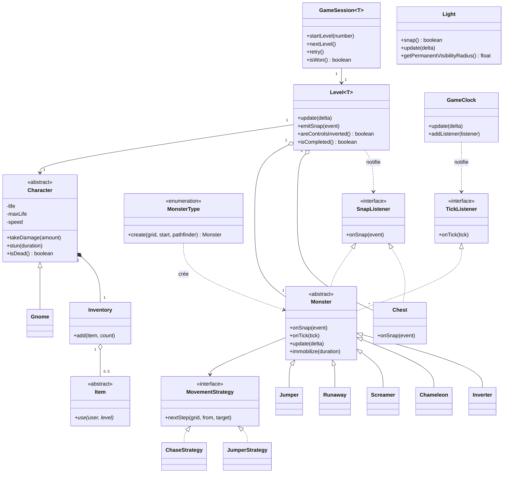
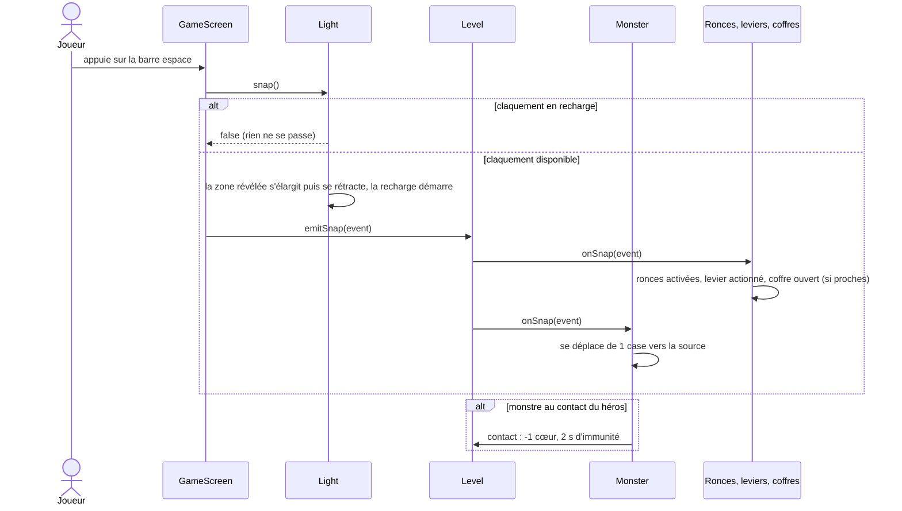

# Blind Path : Game Design Document

> Version 2.0 · Projet 2D Game (Java, LibGDX) · Statut : version du rendu (22/11/2026).
> Cette version décrit le jeu **tel qu'il est livré** : les valeurs chiffrées viennent du code de la branche `dev` (commit `9de942a`, 22/11). Elle remplace la v1.5 du 06/11, qui décrivait le jeu complet à 20 niveaux.
> Tous les points ouverts des versions précédentes sont tranchés. Les écarts avec la v1.5 sont listés en 12.4.

## Sommaire

1. [Présentation générale](#1-présentation-générale)
2. [Concept et expérience de jeu](#2-concept-et-expérience-de-jeu)
3. [Gameplay et mécaniques](#3-gameplay-et-mécaniques)
4. [Contenu du jeu](#4-contenu-du-jeu)
5. [Règles et équilibrage](#5-règles-et-équilibrage)
6. [Interface et contrôles](#6-interface-et-contrôles)
7. [Direction artistique et audio](#7-direction-artistique-et-audio)
8. [Architecture technique](#8-architecture-technique)
9. [Qualité](#9-qualité)
10. [Organisation et planning](#10-organisation-et-planning)
11. [Priorités et pistes d'extension](#11-priorités-et-pistes-dextension)
12. [Annexes](#12-annexes)

---

## 1. Présentation générale

### 1.1 Titre

**Blind Path**

### 1.2 Pitch

Lors de sa toute première expédition avec son père, un jeune gnome chute dans un ancien puits de mine et se réveille au plus profond d'un donjon maléfique. À ses côtés, une lanterne magique : une lanterne qui n'éclaire que lui. D'un claquement de doigts, il peut réveiller sa magie et révéler un bref instant ce qui l'entoure… mais ce bruit attire ce qui rôde dans le noir. Remontez cinq niveaux, déjouez les pièges et les secrets du donjon pour retrouver les vôtres : chaque claquement est un pari entre voir et rester discret.

### 1.3 Genre et perspective

- **Genre :** jeu d'évasion en niveaux successifs, mêlant **exploration, puzzle et horreur**, dans un donjon à l'ambiance sombre et surnaturelle.
- **Perspective :** vue de dessus (2D).
- **Mécanique signature :** la visibilité très réduite. Le personnage porte une **lanterne magique** (une relique, pas une lampe torche) qui, par défaut, **n'éclaire qu'un petit halo autour de lui**. Pour voir plus loin, il doit claquer des doigts, ce qui révèle brièvement les alentours (voir 3.2).

### 1.4 Mécaniques principales

Quatre mécaniques structurent le jeu, détaillées en section 3 :

1. **Claquement de doigts (*snap*)** : la barre espace fait claquer des doigts le héros. Le claquement active la lanterne magique, dont l'effet s'élargit puis se rétracte autour de lui. Un temps de recharge empêche les claquements trop rapprochés.
2. **Des monstres attirés par le bruit** : un monstre est présent dans chaque niveau. Il se déplace au rythme des *ticks* (1/30 de seconde) et réagit à chaque claquement. Il existe cinq types de monstres, un par niveau, chacun avec sa règle propre (voir 4.2).
3. **Des coffres et un inventaire** : les coffres s'ouvrent d'un claquement et donnent un objet. L'inventaire a 5 emplacements. Cinq objets existent, dont deux agissent sur les monstres (voir 4.3).
4. **Des éléments de carte** qui réagissent au claquement : murs à levier et ronces (voir 3.6).

### 1.5 Structure de la progression

Le jeu comporte **5 niveaux**, répartis en quatre paliers de difficulté. Chaque niveau a **un monstre**, et chaque monstre n'apparaît que dans un niveau : la difficulté monte d'abord par le comportement du monstre.

| Niveau | Palier | Carte | Monstre |
|---|---|---|---|
| 1 | Facile (*easy*) | 30 × 30 cases | Jumper |
| 2 | Facile (*easy*) | 30 × 30 cases | Runaway |
| 3 | Moyen (*medium*) | 30 × 30 cases | Screamer |
| 4 | Difficile (*hard*) | 30 × 30 cases | Chameleon |
| 5 | Extrême (*extreme*) | 30 × 30 cases | Inverter |

- **Périmètre réduit (décision du 16/11) :** le jeu complet à 20 niveaux a été ramené à **5 niveaux**, sans sauvegarde, sans boutique ni pièces. Ce choix remplace le plan B de la v1.5 (2 paliers au lieu de 4).
- **Répartition automatique :** les cartes sont rangées par palier dans `assets/maps/1_easy`, `2_medium`, `3_hard` et `4_extreme`. Dans le palier facile, la première moitié des cartes reçoit le Jumper, la seconde le Runaway ; les paliers suivants reçoivent respectivement le Screamer, le Chameleon et l'Inverter.
- **Lanterne :** elle fonctionne de la même façon dans tous les niveaux.
- **Répartition retenue :** 2 niveaux faciles, 1 moyen, 1 difficile et 1 extrême, comme dans le dépôt (décision du 22/11, qui remplace la répartition envisagée le 16/11).

### 1.6 Public visé et inspirations

- **Public visé :** PEGI 12.
- **Jeux de référence :**
  - **Little Nightmares** (série) : c'est l'inspiration principale. Des personnages enfantins y sont confrontés à des monstres aussi difformes que meurtriers. Le contraste entre l'apparence du gnome et celle des monstres y puise son inspiration, de même que l'incapacité du joueur à vaincre les ennemis et la fuite comme seule échappatoire.
  - **The Binding of Isaac** : là aussi pour le contraste entre l'aspect du protagoniste et celui des ennemis, mais aussi pour le système d'objets. Dans ce jeu comme dans Blind Path, le joueur ramasse des objets aux effets variés qui l'aident à progresser.
  - **Le genre du roguelite**, dans lequel on conserve tout ou partie de son inventaire après une défaite.

### 1.7 Périmètre du POC

Le projet est une preuve de concept (POC) jouable, présentée en démonstration lors de la soutenance.

**Contenu livré :**
- 5 niveaux sur les 4 paliers (voir 1.5) ;
- la mécanique de la lanterne (claquement de doigts) et le voile d'obscurité ;
- les 5 types de monstres : Jumper, Runaway, Screamer, Chameleon et Inverter ;
- les coffres, l'inventaire et 5 objets : dynamite, cœur, piège à ours, boussole, recharge magique ;
- les éléments de carte : murs à levier et ronces ;
- la vie en demi-cœurs, la mort et le *retry* ;
- un HUD, un menu principal, une introduction animée, une pause et un écran de fin ;
- les sons des monstres, du héros et l'ambiance du donjon.

**Hors périmètre pour le POC :**
- le développement de l'histoire ;
- les personnages secondaires ;
- la sauvegarde, les pièces, la boutique, les améliorations et les compétences (Dash, Instinct, Double claquement) ;
- l'épée, la montre et la pièce ;
- les murs fantômes, les faux murs et les portails ;
- un jeu à 20 niveaux ou plus.

### 1.8 Équipe

Équipe de quatre personnes : **Pierre, Grégoire, Xavier et Aurélien**.

| Membre | Rôle principal |
|---|---|
| Pierre | Direction artistique, assets graphiques et sonores, interface (HUD), UML |
| Grégoire | Développement : niveaux, moteur et collisions, chaînage des niveaux |
| Xavier | Développement : héros et objets, rédaction (GDD, README) |
| Aurélien | Développement : lanterne et monstres, gestion de production |

---

## 2. Concept et expérience de jeu

### 2.1 Piliers du jeu

1. **Voir ou rester discret.** Le personnage ne voit qu'autour de lui. Pour voir le niveau, il doit claquer des doigts, et chaque claquement attire le monstre.
2. **Un donjon à résoudre.** Chaque niveau est un petit labyrinthe : leviers à actionner, ronces à éviter et coffres à ouvrir dans le noir.
3. **L'angoisse de la traque.** Le monstre avance sans cesse ; le joueur sait qu'il est là sans le voir, et chacun a sa façon de le piéger.
4. **Se débrouiller avec peu.** Les objets trouvés dans les coffres permettent de survivre, de retarder le monstre ou de trouver la sortie.

### 2.2 Contexte et fil conducteur

Un jeune gnome, **Gudule Ier**, lors de sa première sortie d'exploration avec son père, tombe dans un ancien puits de mine. Il se réveille au plus profond d'un donjon, à côté d'une relique magique, une lanterne dont la magie est presque épuisée. Son objectif : remonter les cinq niveaux du donjon pour retrouver les siens.

> Le développement de l'histoire est hors périmètre du POC (voir 1.7) : ce contexte est posé par l'introduction animée, sans dialogues.

### 2.3 Boucle de jeu

Dans chaque niveau :

1. Le joueur se déplace dans l'obscurité ; seul un petit halo autour de son personnage est éclairé.
2. Quand il a besoin de s'orienter, il claque des doigts : la lanterne révèle les alentours, puis la zone se rétracte.
3. Le claquement attire le monstre vers sa source, déclenche les ronces proches, actionne les leviers proches et ouvre les coffres proches ; le claquement entre en recharge.
4. Le joueur mémorise ce qu'il a vu, évite les ronces et utilise ses objets.
5. Il rejoint la sortie du niveau, ce qui charge le niveau suivant.

L'objectif est de **garder une visibilité suffisante sur le niveau pour le résoudre, tout en tenant le monstre à distance**.

### 2.4 Conditions de victoire et de défaite

- **Fin d'un niveau :** atteindre la sortie du niveau.
- **Victoire :** réussir les 5 niveaux, c'est-à-dire sortir du donjon en terminant le niveau 5. Un écran de fin s'affiche, puis le jeu revient au menu.
- **Mort :** quand le héros n'a plus de vie, le jumpscare du monstre se joue, puis le héros réapparaît **au début du palier en cours** (*die and retry*). Il retrouve **toute sa vie** et **garde son inventaire**. Il n'y a pas de fin de partie définitive.

### 2.5 Difficulté et progression

La difficulté monte d'un niveau à l'autre par le **type de monstre** : le Jumper et le Runaway se lisent facilement, le Screamer punit les claquements trop nombreux, le Chameleon reste invisible jusqu'au dernier moment, et l'Inverter retourne les contrôles du joueur. Il n'y a pas de progression du personnage entre les niveaux, hormis l'inventaire, qui est conservé.

## 3. Gameplay et mécaniques

### 3.1 Vue d'ensemble

Le joueur traverse les niveaux l'un après l'autre jusqu'à la sortie du donjon. Dans chaque niveau, il doit rejoindre la sortie malgré l'obscurité et la présence d'un monstre.

- **Déplacement du joueur :** libre (continu), et non case par case, dans **8 directions**, à **2,75 cases par seconde**. Les murs bloquent le héros grâce au moteur de collisions.
- **Déplacement des monstres :** par cases, au rythme des *ticks* (voir 3.3). Ils suivent le chemin le plus court vers le joueur (algorithme A\*).
- **Case :** unité de distance sur la carte. Une carte fait 30 × 30 cases.
- **Objectif d'un niveau :** atteindre la sortie, toujours ouverte.

### 3.2 Lanterne magique et claquement de doigts

- **Éclairage de base :** par défaut, la lanterne éclaire un **halo de 0,8 case** autour du personnage. Le reste du niveau est couvert d'un voile noir.
- **Claquement de doigts (*snap*) :** la barre espace fait claquer des doigts le héros. L'effet de la lanterne **s'élargit autour de lui jusqu'à 4,5 cases, puis se rétracte**, en **1 seconde**, et l'obscurité revient.
- **Temps de recharge :** après un claquement, il faut attendre **1,5 seconde** avant de pouvoir claquer à nouveau. Un claquement pendant la recharge est ignoré. Une jauge du HUD montre la recharge.
- **Sources de claquement :** un claquement peut venir du **héros** ou d'une **dynamite** (à sa position). Chaque claquement attire le monstre vers sa source et déclenche les ronces (voir 3.3 et 3.6). Seul le claquement du héros actionne les leviers.
- **Effet des objets :** la recharge magique multiplie le rayon révélé par **1,5** pendant 5 claquements (voir 4.3).
- **Règle de conception :** les monstres réagissent **uniquement au claquement**, jamais à la lumière. La lumière est purement visuelle.

### 3.3 Monstres

**Règles générales**

- **Un monstre par niveau** poursuit le joueur (voir 1.5).
- **Pas de points de vie :** les monstres ne peuvent pas être tués. Le joueur les attire ailleurs (dynamite) ou les immobilise (piège à ours).
- **Ticks :** un tick dure **1/30 de seconde** (30 ticks = 1 s). Un monstre se déplace de N cases tous les T ticks. **Valeur par défaut : 1 case tous les 30 ticks**, soit 1 case par seconde. Chaque type peut changer ces valeurs (voir 4.2).
- **Chemin :** chaque monstre choisit le chemin le plus court vers le joueur en contournant les murs.
- **À chaque claquement :** le monstre se déplace immédiatement de **1 case vers la source du claquement**, en plus de son déplacement par ticks. Le Runaway fait exception (voir 4.2).
- **Emprise :** un monstre occupe **2 × 2 cases**, pour tous les types.
- **Monstre immobilisé :** il ne se déplace plus, ni par ticks ni vers un claquement, jusqu'à la fin de l'immobilisation.

**Contact avec le héros**

- Le contact retire **1 cœur** (2 points de vie) au héros, avec un voile rouge et un son de dégât.
- Le héros est alors **immunisé pendant 2 secondes** : un nouveau contact ne lui retire rien pendant ce temps.

### 3.4 Coffres et inventaire

- **Coffres :** un coffre s'ouvre quand **un claquement a lieu à côté de lui** (à 1 case de son bord environ). Il donne **un objet**, tiré au hasard parmi les 5 objets, avec la même chance pour chacun. Une carte peut aussi imposer le contenu d'un coffre.
- **Inventaire :** 5 emplacements, soit **5 objets différents au maximum**. Les objets de même type se cumulent jusqu'à **5 par pile**. Le surplus qui ne peut pas être stocké disparaît. Pour utiliser un objet, le joueur appuie sur la touche de son emplacement (**1 à 5**).
- **Cœur :** s'utilise automatiquement dès qu'il manque de la vie au héros ; il reste dans l'inventaire si la santé est pleine. Il ne ressuscite pas un héros mort.

### 3.5 Progression et retry

- 5 niveaux en quatre paliers (voir 1.5). Atteindre la sortie charge le niveau suivant ; la carte d'après est préchargée en arrière-plan.
- **Pas de sauvegarde :** une partie se joue d'une traite.
- **Mort et retry :** après sa mort, le joueur réapparaît au début du palier en cours (en pratique au début du même niveau, ou au niveau 1 s'il meurt au niveau 2). Il retrouve toute sa vie, garde son inventaire, et ses effets en cours (boussole, recharge magique, étourdissement) sont annulés. Les monstres ne sont **pas renforcés**.

### 3.6 Éléments de la carte

| Élément | Déclencheur | Comportement |
|---|---|---|
| Mur à levier | Claquement du héros à **2 cases ou moins** du levier | Le mur associé pivote de **90°** autour de son pivot. Une fois pivoté, le mur reste en place. La rotation est refusée si le héros ou le monstre se trouve sur son passage ; il faut alors claquer à nouveau. |
| Ronces | Tout claquement à **3 cases ou moins** | Les ronces s'activent pendant **0,5 s**. Le contact avec le héros pendant ce temps lui retire **1 cœur** (2 points de vie). |

- Les claquements de **dynamite** déclenchent aussi les ronces.
- Les murs, l'entrée, la sortie, les leviers, les ronces et les coffres sont placés à la main dans les cartes Tiled (voir 8.8).

### 3.7 Entrées et temps

- Les entrées se font **au clavier**. Déplacement aux **flèches directionnelles** ou **W, A, S, D**, claquement de doigts à la **barre espace**, utilisation des objets aux touches **1 à 5** (ou pavé numérique), pause à **Échap**.
- Le jeu fonctionne en **temps réel** : l'état du jeu est mis à jour à chaque image, en fonction du temps écoulé. Les monstres avancent par ticks, de façon régulière, grâce à une horloge de jeu (`GameClock`).

## 4. Contenu du jeu

### 4.1 Personnage jouable

| Nom | Caractéristiques | Capacités |
|---|---|---|
| Gudule Ier, le jeune gnome | Vie : 3 cœurs (6 points de vie), sans amélioration possible · Vitesse : 2,75 cases/s · 8 directions · Emprise : 1 × 1 case · Inventaire : 5 emplacements, piles de 5 | Claquement de doigts ; utilisation des objets |

- **Vie en demi-cœurs :** la vie se compte en points entiers, et **1 cœur = 2 points**. Un monstre ou des ronces retirent un cœur entier ; le HUD sait afficher les demi-cœurs.
- **Étourdissement :** un héros étourdi (cri du Screamer) ne peut plus se déplacer pendant la durée de l'effet.

### 4.2 Monstres

Cinq types de monstres, un par niveau. Aucun n'a de points de vie. Les rythmes sont exprimés en cases et en secondes (1 s = 30 ticks).

| Monstre | Déplacement | Comportement |
|---|---|---|
| **Jumper** (niveau 1) | 1 case par seconde | Quand le joueur est à **2 cases ou moins**, il s'arrête un déplacement pour **alerter**, puis **saute sur la case du joueur** si elle est libre. Sinon, il reprend sa poursuite. |
| **Runaway** (niveau 2) | 2 cases toutes les 2 secondes | Se dirige vers le joueur par défaut. À chaque claquement, au lieu de venir vers le bruit, il **recule de 3 cases vers la sortie** : il s'interpose entre le joueur et la fin du niveau. |
| **Screamer** (niveau 3) | 1 case par seconde | Compte les claquements (du joueur et de la dynamite). Après un nombre tiré au hasard **entre 5 et 8**, il pousse un **cri** : le héros est **étourdi 3 s**, où qu'il soit. Le cri est visible au-dessus du voile pendant 1 s. Le compteur repart à zéro et un nouveau seuil est tiré. |
| **Chameleon** (niveau 4) | 1 case par seconde | Invisible. Il n'est dessiné que lorsqu'il est à **3 cases ou moins** du joueur, et toujours **sous le voile** : on ne le voit que dans la lumière de la lanterne ou d'un claquement. |
| **Inverter** (niveau 5) | 1 case par seconde | Inverse les **contrôles de déplacement** du joueur (haut ↔ bas, gauche ↔ droite) tant que celui-ci est à **3 cases ou moins**. L'inversion **dure encore 3 s** après la sortie de sa zone : un joueur qui a pris de l'avance peut s'échapper. Une icône du HUD signale l'inversion et clignote pendant ces 3 s. |

- **Mesure des distances :** les portées du Chameleon et de l'Inverter se mesurent en carré autour du monstre (le plus grand des deux écarts, en colonnes ou en lignes). La portée du Jumper se mesure en nombre de cases à parcourir (écart en colonnes + écart en lignes).
- **Mort :** chaque monstre a son propre jumpscare (image et son) quand il tue le héros.

### 4.3 Objets (équipement)

L'inventaire a 5 emplacements, avec des piles de 5 objets maximum (voir 3.4). Seuls la dynamite et le piège à ours agissent sur les monstres.

| Objet | Fonctionnement | Durée ou quantité |
|---|---|---|
| **Dynamite** | Posée à l'endroit du joueur. Après le compte à rebours, elle explose et émet un **claquement à sa position** : le monstre se déplace vers elle, et les ronces proches se déclenchent. Le contact d'un monstre n'a pas d'effet. | Explosion après **3 s** |
| **Cœur** | Redonne **1 cœur** (2 points de vie), sans dépasser le maximum. S'utilise automatiquement dès qu'il manque de la vie ; reste dans l'inventaire si la santé est pleine. | +2 points de vie |
| **Piège à ours** | Posé au sol, il **immobilise** le monstre qui passe dessus, puis disparaît. | Immobilisation de **3 s** |
| **Boussole** | Une flèche tourne autour du héros et **indique la sortie**. | **5 s** |
| **Recharge magique** | Agrandit le rayon révélé par la lanterne. Impossible à utiliser si une recharge est déjà en cours. | Rayon × 1,5 pendant **5 claquements** |

### 4.4 Niveaux et éléments du monde

- 5 niveaux en grille de 30 × 30 cases, **dessinés à la main** avec l'éditeur Tiled (fichiers `.tmx`).
- Éléments : murs, entrée, sortie, coffres, murs à levier, ronces (voir 3.6).
- Un index des cartes (`assets/maps/index.txt`) est généré par Gradle ; ajouter une carte dans le bon dossier de palier suffit à l'intégrer au jeu.

### 4.5 Personnages non jouables

Aucun dans le POC (personnages secondaires hors périmètre, voir 1.7). Le père du gnome n'existe que dans le contexte.

## 5. Règles et équilibrage

> Cette section fournit les **valeurs attendues des tests unitaires** (voir 9.1). Chaque règle a un exemple chiffré. Les valeurs sont celles du code au 22/11.

| Règle | Formule ou valeur | Exemple attendu |
|---|---|---|
| Vie | Départ et maximum : 6 points (3 cœurs). 1 cœur = 2 points. | Héros neuf : 6 points, 3 cœurs pleins |
| Contact avec un monstre | −2 points, puis 2 s d'immunité | 6 → 4 points ; un second contact 1 s plus tard n'enlève rien |
| Ronces | −2 points au contact pendant 0,5 s après un claquement à 3 cases ou moins | Héros dans les ronces au moment d'un claquement : −2 points |
| Cœur | +2 points, sans dépasser 6, utilisé automatiquement | 3 points + 1 cœur = 5 ; 6 points : le cœur reste dans l'inventaire |
| Inventaire | 5 emplacements, piles de 5, surplus perdu | Pile de 4 dynamites + 3 : pile à 5, 2 perdues |
| Claquement | Révélation de 4,5 cases pendant 1 s, recharge de 1,5 s, halo permanent de 0,8 case | Deux claquements séparés de 1 s : le second est ignoré |
| Recharge magique | Rayon × 1,5 pendant 5 claquements | Rayon de 4,5 → 6,75 ; au 6e claquement, 4,5 |
| Dynamite | Claquement à sa position 3 s après la pose | Posée à t = 0 : claquement à t = 3 s |
| Piège à ours | Monstre immobilisé 3 s | Immobilisé à t = 0 : il ne bouge pas avant t = 3 s |
| Boussole | Flèche vers la sortie pendant 5 s | Utilisée à t = 0 : flèche visible jusqu'à t = 5 s |
| Tick | 1 tick = 1/30 de seconde | 30 ticks = 1 s |
| Rythme de base d'un monstre | 1 case tous les 30 ticks | Après 3 s (90 ticks) : 3 cases |
| Claquement et monstre | Le monstre fait 1 case vers la source | Monstre à 5 cases d'une dynamite qui explose : à 4 cases |
| Jumper | Alerte puis saut si le joueur est à 2 cases ou moins | Joueur à 2 cases : alerte, puis saut sur sa case |
| Runaway | 2 cases toutes les 60 ticks ; 3 cases vers la sortie à chaque claquement | Un claquement : le Runaway recule de 3 cases vers la sortie |
| Screamer | Seuil tiré entre 5 et 8 claquements, cri qui étourdit 3 s, compteur remis à zéro | Seuil 6 : cri au 6e claquement, puis compteur à 0 |
| Chameleon | Visible à 3 cases ou moins | Joueur à 3 cases : visible ; à 4 cases : invisible |
| Inverter | Contrôles inversés à 3 cases ou moins, puis encore 3 s après la sortie de zone | Sortie de zone à t = 0 : inversé jusqu'à t = 3 s, normal ensuite |
| Contenu d'un coffre | 1 objet parmi 5, même chance pour chacun | Chaque objet tombe avec une chance sur cinq |
| Objets et touches | Emplacement 1 à 5 = touche 1 à 5 | Touche 3 : utilise l'objet de l'emplacement 3 |
| Mort | Retour au début du palier en cours, vie pleine, inventaire conservé | Mort au niveau 2 : retour au niveau 1 avec l'inventaire |

**Cas limites tranchés :** cœur avec santé pleine (le cœur reste dans l'inventaire), pile pleine (surplus perdu), claquement pendant la recharge (ignoré), monstre immobilisé attiré par une dynamite (il ne bouge pas), recharge magique déjà active (refusée), saut du Jumper vers une case bloquée (il reprend sa poursuite), levier gêné par le héros ou le monstre (pas de rotation).

## 6. Interface et contrôles

### 6.1 Écrans

- **Introduction :** une courte animation pose le contexte ; Échap permet de la passer.
- **Menu principal :** boutons *Start* et *Quit*, avec une musique de menu.
- **Jeu.**
- **Pause** (Échap) : *Reprendre*, *Retour au menu*, *Quit*.
- **Fin de partie** (victoire) : message de fin pendant 6 s, puis retour au menu.

### 6.2 Interface en jeu (HUD)

- **À gauche :** une jauge verticale de recharge du claquement, puis les **3 cœurs** (pleins, à moitié ou vides) en dessous, puis l'**icône d'inversion des contrôles** quand l'Inverter agit.
- **Sur le côté droit :** les 5 emplacements d'inventaire, avec l'icône de chaque objet et sa quantité.
- **En haut à droite :** le numéro du niveau (« Niveau N »).

### 6.3 Touches

| Action | Touche |
|---|---|
| Se déplacer (8 directions) | Flèches directionnelles ou W, A, S, D |
| Claquer des doigts (et actionner un levier, ouvrir un coffre) | Barre espace |
| Utiliser un objet | Touches 1 à 5, ou pavé numérique 1 à 5 (emplacement de l'objet) |
| Pause | Échap |
| Debug : collisions et monstre visibles | F3 |
| Debug : invincibilité | I |

### 6.4 Retours au joueur

- Son du claquement de doigts et onde visuelle de la lanterne qui s'élargit puis se rétracte.
- Bruit de pas du gnome quand il se déplace.
- Dégâts : voile rouge de 0,5 s et son de dégât ; cœurs mis à jour dans le HUD.
- Proximité du monstre : chaque monstre a un son de déplacement dont le **volume augmente quand il se rapproche**.
- Cri du Screamer : son et animation visibles même dans le noir.
- Inversion des contrôles : icône dans le HUD, qui clignote pendant les 3 dernières secondes.
- Boussole : flèche qui tourne autour du héros.
- Mort : jumpscare plein écran (image et son) du monstre responsable.

## 7. Direction artistique et audio

- **Style visuel :** 2D en pixel art, vue de dessus. Les visuels ont été **générés par IA** (ChatGPT) puis intégrés et assemblés par Pierre (atlas d'animation, tuiles). Les conditions d'utilisation d'OpenAI laissent à l'utilisateur les droits sur les images générées, ce qui permet de les utiliser dans le jeu.
- **Lanterne magique :** relique au design de lanterne, avec une onde qui s'élargit puis se rétracte.
- **Monstres :** 5 designs (Jumper, Runaway, Screamer, Chameleon, Inverter), animés selon leur direction, sur 2 × 2 cases, chacun avec une image de jumpscare.
- **Interface :** cœurs en pixel art (pleins, demi, vides), icônes des 5 objets, icône d'inversion aux couleurs de l'Inverter.
- **Éléments de carte :** tuiles de sols, murs et décors stylisés, ronces animées, leviers et murs pivotants, coffres.
- **Musique et effets sonores (Pierre) :** ambiance du donjon en boucle, musique du menu, claquement de doigts, pas et dégâts du gnome, déplacement et jumpscare de chaque monstre, cri du Screamer. Tous les sons et musiques viennent de **Pixabay** : leur licence (*Pixabay Content License*) permet de les utiliser gratuitement dans un jeu, sans obligation de citer l'auteur.
- Rappel du sujet : le gameplay passe avant l'aspect graphique.

## 8. Architecture technique

### 8.1 Stack technique

| Domaine | Choix | Remarque |
|---|---|---|
| Langage | Java | Java 21 LTS |
| Moteur de jeu | LibGDX | Projet généré avec gdx-liftoff, plateforme desktop (LWJGL3) |
| Collisions | Box2D (extension LibGDX) | Une version en Java pur (`AabbCollisionWorld`) sert aux tests |
| Recherche de chemin | gdx-ai (A\*) | Derrière l'interface `Pathfinder` |
| Cartes | Tiled (`.tmx`) | Chargées par `TiledLabyrinthLoader` |
| Build et dépendances | Gradle | Wrapper `gradlew` versionné |
| Tests unitaires | JUnit 5 | |
| Couverture de tests | JaCoCo | Rapport généré après chaque `gradlew test` |
| Documentation du code | Javadoc | Workflow GitHub Actions dédié |
| Diagrammes UML | Mermaid | |
| Suivi des tâches | GitHub Projects | |

### 8.2 Principes d'architecture

- **Séparation logique / affichage.** Les règles du jeu (lanterne, monstres, inventaire, éléments de carte, niveaux, victoire) sont codées dans le package `domain`, **indépendant de LibGDX**. Elles sont testées avec JUnit sans ouvrir de fenêtre.
- **Programmation orientée objet :** encapsulation, polymorphisme (monstres, objets, objets posés), composition plutôt qu'héritage quand c'est possible (stratégies de déplacement), interfaces pour découpler (`Pathfinder`, `CollisionWorld`, `LabyrinthLoader`, `SnapListener`).
- **Un seul sens de dépendance :** l'affichage et l'infrastructure dépendent de la logique, jamais l'inverse.
- **Aléatoire maîtrisé :** le contenu des coffres et le seuil du Screamer passent par un générateur aléatoire transmis en paramètre, pour pouvoir fixer le résultat dans les tests.
- **Temps maîtrisé :** les ticks et les durées (immunité, étourdissement, immobilisation, révélation, recharge) sont calculés à partir du temps écoulé transmis à la logique (`GameClock`, `GameTimer`), ce qui permet de les tester sans attendre.

### 8.3 Découpage en packages

```
com.blindpath
├── domain            logique du jeu, en Java pur
│   ├── character     Character, Gnome, Direction
│   ├── chest         Chest, LootTable
│   ├── game          GameSession, Level, LevelFactory, LevelConfig
│   ├── inventory     Inventory, Item et les 5 objets
│   ├── labyrinth     Labyrinth, murs, entrée, sortie, leviers, ronces
│   ├── light         Light, SnapEvent, SnapListener
│   ├── monster       Monster, les 5 monstres, MonsterType, stratégies de déplacement
│   ├── object        objets posés au sol (dynamite, piège à ours)
│   ├── pathfinding   LabyrinthGrid, GridPosition, Pathfinder
│   ├── physics       CollisionWorld
│   └── time          GameClock, GameTimer, TickListener
├── infrastructure    adaptateurs LibGDX : cartes Tiled, Box2D, gdx-ai
└── presentation      écrans, rendu, HUD, entrées clavier, audio
```

### 8.4 Boucle de jeu et gestion du temps

À chaque image, LibGDX appelle la méthode de rendu de l'écran courant avec le temps écoulé (*delta*). La boucle suit toujours le même ordre : **lire les entrées, mettre à jour la logique** (héros, horloge, monstre, niveau), **puis dessiner** (carte, objets, voile d'obscurité, héros, HUD).

- Le héros se déplace de façon continue : sa position avance de `vitesse × delta`, et le moteur de collisions l'arrête contre les murs.
- L'horloge compte le temps en **ticks de 1/30 s** et prévient le monstre à chaque tick. Un monstre se déplace de N cases tous les T ticks (par défaut 1 case tous les 30 ticks). Un claquement lui fait faire un déplacement supplémentaire.
- Le temps écoulé sert aussi aux durées : révélation, recharge, immunité de 2 s, étourdissement de 3 s, piège à ours, dynamite à 3 s, ronces actives 0,5 s, inversion prolongée de 3 s.

### 8.5 Classes principales

| Classe | Responsabilité |
|---|---|
| `GameSession<T>` | État global d'une partie : niveau courant, héros, passage au niveau suivant, victoire, retry. |
| `Level<T extends Character>` | Contenu d'un niveau : labyrinthe, héros, monstre, coffres, objets posés ; diffuse les claquements. |
| `LevelFactory` | Construit un `Level` à partir de la carte et du monstre prévus pour ce numéro de niveau. |
| `Character` (classe abstraite) | Position continue, vie en points, immunité, étourdissement, inventaire, effets en cours. |
| `Gnome` | Le héros jouable. |
| `Light` | La lanterne : halo, claquement, rayon, durée, recharge, effet de la recharge magique. |
| `Monster` (classe abstraite) | Position sur la grille, rythme en ticks, réaction au claquement, immobilisation. |
| `Jumper`, `Runaway`, `Screamer`, `Chameleon`, `Inverter` | Les cinq types de monstres (voir 4.2). |
| `MonsterType` (énumération) | Fabrique d'un monstre à partir de son type. |
| `MovementStrategy` (interface) | Règle de déplacement : `ChaseStrategy` (poursuite), `JumperStrategy` (alerte puis saut). |
| `GameClock`, `TickListener` | Horloge de jeu à 30 ticks/s et ses écouteurs (les monstres). |
| `SnapListener` (interface) | Écouteur d'un claquement (monstre, ronces, coffres). |
| `Inventory`, `ItemStack` | 5 emplacements, piles de 5, surplus perdu, soin automatique. |
| `Item` (classe abstraite) | Objet de l'inventaire : `Dynamite`, `Heart`, `BearTrap`, `Compass`, `Booster`. |
| `PlacedObject` (classe abstraite) | Objet posé au sol : `PlacedDynamite`, `PlacedBearTrap`. |
| `Chest`, `LootTable` | Coffre d'un niveau et tirage de son contenu. |
| `Lever`, `RotatingWall`, `Bramble` | Éléments de carte (voir 3.6). |
| `Hud` | Affichage de la jauge, des cœurs, de l'inventaire, du niveau et de l'icône d'inversion. |

### 8.6 Design patterns

| Pattern | Où | Problème résolu |
|---|---|---|
| **Observer** | `Level.emitSnap` → `SnapListener` (monstre, ronces, coffres) ; `GameClock` → `TickListener` (monstre) | Tout ce qui réagit à un claquement ou à un tick le fait sans que la source le connaisse. |
| **Strategy** | `Monster` → `MovementStrategy` (`ChaseStrategy`, `JumperStrategy`) ; `Pathfinder` | Faire varier la façon de se déplacer sans multiplier les `if/else`. |
| **Factory** | `MonsterType`, `LevelFactory`, `ItemType` | Centraliser la création des monstres, des niveaux et des objets tirés dans les coffres. |
| **State** | `JumperState` (poursuite, alerte) | Gérer proprement l'alerte puis le saut du Jumper. |
| **Adapter** | `Box2DCollisionWorld`, `GdxAiPathfinder`, `TiledLabyrinthLoader` | Brancher les bibliothèques LibGDX derrière des interfaces du domaine, testables sans elles. |

### 8.7 Diagrammes UML

Les diagrammes sont écrits en Mermaid, dans le dossier [`docs/uml/`](uml/README.md) du dépôt : GitHub les dessine directement quand on ouvre un fichier. Ils sont générés à partir du code de `core/src/main/java` (branche `dev`, 22/11/2026) et découpés en modules :

| Fichier | Contenu |
|---|---|
| [README](uml/README.md) | Mode d'emploi des diagrammes (notation) et patrons de conception |
| [00_Vue_ensemble](uml/00_Vue_ensemble.md) | Toutes les classes principales et leurs liens, sans détail |
| [01_Personnage](uml/01_Personnage.md) | `domain.character` : Character, Gnome, Direction, Movable |
| [02_Jeu_et_niveaux](uml/02_Jeu_et_niveaux.md) | `domain.game` : GameSession, Level, LevelFactory, LevelConfig, LevelCatalog |
| [03_Labyrinthe](uml/03_Labyrinthe.md) | `domain.labyrinth` : Labyrinth, obstacles, entrée, sortie, Collidable |
| [04_Monstres](uml/04_Monstres.md) | `domain.monster` : Monster, les 5 monstres, MovementStrategy, MonsterType |
| [05_Lumiere_et_snap](uml/05_Lumiere_et_snap.md) | `domain.light` : Light, SnapEvent, SnapListener |
| [06_Inventaire_et_objets](uml/06_Inventaire_et_objets.md) | `domain.inventory` et `domain.object` : Inventory, les 5 objets, objets posés |
| [07_Coffres](uml/07_Coffres.md) | `domain.chest` : Chest, LootTable, LootResult |
| [08_Pathfinding](uml/08_Pathfinding.md) | `domain.pathfinding` et `infrastructure.pathfinding` |
| [09_Temps](uml/09_Temps.md) | `domain.time` : GameClock, GameTimer, TickListener |
| [10_Physique](uml/10_Physique.md) | `domain.physics` et `infrastructure.physics` : CollisionWorld, AABB, Box2D |
| [11_Chargement_des_cartes](uml/11_Chargement_des_cartes.md) | `infrastructure.map` : Tiled, LevelRegistry |
| [12_Ecrans_HUD_et_audio](uml/12_Ecrans_HUD_et_audio.md) | `Main`, `presentation.screen`, `hud`, `input`, `audio` |
| [13_Rendu](uml/13_Rendu.md) | `presentation.renderer` |

Les deux diagrammes ci-dessous en donnent un aperçu rapide ; la référence reste `docs/uml/`.

**Classes principales (vue simplifiée) :**



**Séquence : claquement de doigts :**



### 8.8 Ressources et niveaux

- Les images et sons sont stockés dans le dossier `assets` : `gnome`, `monsters` (un dossier par monstre, avec son atlas d'animation et son jumpscare), `items`, `chest`, `ui`, `audio`, `animations` et `maps`.
- **Cartes :** fichiers Tiled (`.tmx`) de 30 × 30 cases, rangés par palier dans `assets/maps/1_easy` à `4_extreme`. Les objets de la carte (murs, entrée, sortie, leviers et leurs murs, ronces, coffres) sont lus par `TiledLabyrinthLoader`.
- **Obscurité :** un voile noir est dessiné par-dessus la carte (`FogRenderer`), troué autour du héros et de la zone révélée par le claquement.
- **Sauvegarde :** aucune (hors périmètre).

## 9. Qualité

### 9.1 Tests unitaires

Les tests portent sur la **logique du jeu** (package `domain`), sans interface graphique. Le projet compte près de **500 tests**, tous verts sur `dev` au 22/11. Exemples de comportements vérifiés :

- **Horloge :** 30 ticks par seconde, prévention des écouteurs à chaque tick, minuteurs.
- **Claquement :** révélation puis rétraction de la zone, refus pendant la recharge, effet de la recharge magique.
- **Santé :** dégâts en demi-cœurs, immunité de 2 s, mort à 0 point, soin plafonné.
- **Inventaire :** 5 emplacements, piles limitées à 5, surplus perdu, cœur utilisé seulement s'il manque de la vie.
- **Objets :** dynamite (claquement après 3 s), piège à ours (immobilisation de 3 s), boussole, recharge magique.
- **Monstres :** déplacement selon les ticks, chemin le plus court autour des murs, réaction au claquement, alerte et saut du Jumper, recul du Runaway vers la sortie, cri du Screamer (générateur aléatoire fixé), visibilité du Chameleon, inversion de l'Inverter et ses 3 s prolongées.
- **Éléments de carte :** leviers et murs pivotants, ronces (portée, durée, dégâts), ouverture des coffres.
- **Niveaux :** chargement des cartes, attribution des monstres par palier, passage au niveau suivant, victoire, retry au début du palier.

Les règles chiffrées de la section 5 fournissent les valeurs attendues des tests.

### 9.2 Couverture

La couverture est mesurée avec **JaCoCo** ; le rapport est généré après chaque lancement des tests. L'objectif visé est de **75 à 85 %** sur le package `domain`.

### 9.3 Intégration continue

Trois workflows **GitHub Actions** tournent sur le dépôt :

- **Tests** (`tests.yml`) : à chaque push et à chaque pull request vers `dev` ou `main`, il lance les tests JUnit et calcule la couverture JaCoCo (`./gradlew :core:test :core:jacocoTestReport`). Les rapports de tests et de couverture sont joints au run, même quand un test échoue.
- **Javadoc** (`javadoc.yml`) : génère la Javadoc.
- **Javadoc dans main** (`javadoc-main.yml`) : commite la Javadoc dans `docs/javadoc/` sur `main` à chaque fusion de `dev` dans `main`.

### 9.4 Documentation du code

Les classes et les méthodes importantes sont documentées en **Javadoc**, générée par Gradle et publiée dans `docs/javadoc/` sur la branche `main`.

### 9.5 Organisation du dépôt

- **Branches :** `main` (stable, jalons), `dev` (intégration, branche par défaut), une branche par tâche nommée `feature/<ID de la tâche>-<2 ou 3 mots>`, créée depuis `dev`.
- **Pull requests :** toute modification passe par une PR vers `dev`, fusionnée en *squash* par son auteur. Le passage de `dev` vers `main` se fait aux jalons, par commit de fusion.
- **Commits :** en **français**, avec le numéro de l'issue GitHub, par exemple `POC_EXTREME-3 Inverter : contrôles encore inversés 3 s après la sortie de zone (#82)`.
- **Suivi :** chaque tâche est une issue GitHub, suivie dans un GitHub Project.
- **Langue :** le jeu, le code et les labels GitHub sont en anglais ; les tâches et les commits sont en français.

## 10. Organisation et planning

Le détail des jalons, des issues et des tâches est tenu dans les milestones du dépôt GitHub et dans le GitHub Project.

### 10.1 Jalons

| Jalon | Dates | Remarque |
|---|---|---|
| Bootstrap | 02 → 05/11 | Jeu console et LibGDX, prise en main de LibGDX. |
| Project setup | 03 → 09/11 | Dépôt, templates, jalons, labels. |
| GDD | 02 → 06/11 | v1.5 le 06/11 ; v2.0 au rendu (cette version). |
| Core assets et Core UML | 06 → 11/11 | Sprites du gnome et des monstres, UML par module. |
| Prototype level | 06 → 12/11 | Squelette, horloge, lanterne, premier monstre et snap. |
| Périmètre réduit | 16/11 | 5 niveaux, sans sauvegarde ni boutique (voir 1.5). |
| POC, paliers facile à extrême | 12 → 21/11 | Vie en demi-cœurs (18-19/11), objets réduits à 5 (19/11), Runaway et Inverter (20/11), Screamer, Chameleon, chaînage des niveaux et sons (21/11). |
| Final review | 21 → 22/11 | Équilibrage des monstres, HUD de l'Inverter, GDD, Javadoc, UML. |
| Rendu | **22/11** | |

### 10.2 Répartition des responsabilités

| Membre | Module | Spécialité transverse |
|---|---|---|
| Aurélien | Lanterne et monstres : horloge, claquement, recherche de chemin, effets sur les monstres, les 5 monstres | Planification, GitHub |
| Grégoire | Niveaux et moteur : squelette, labyrinthe, collisions, chargement des cartes, chaînage des niveaux, retry | Relecture technique, réparation de `dev` |
| Pierre | Affichage et interface : voile noir, menus, HUD, renderers | Assets graphiques et sonores, UML |
| Xavier | Héros et objets : vie, inventaire, coffres, objets | Rédaction : GDD, README |

### 10.3 Outils

GitHub Projects (suivi), Mermaid (UML), GitHub Actions (Javadoc), Gradle et LibGDX (voir 8.1), Tiled (cartes), Teams (communication).

### 10.4 Risques et plan B

| Risque | Ce qui a été fait |
|---|---|
| 20 niveaux, 5 monstres, 8 objets et 3 compétences : trop long à produire | **Périmètre réduit le 16/11 :** 5 niveaux, 5 objets, sans compétences ni sauvegarde. |
| Rendu de l'obscurité plus difficile que prévu | Voile noir dessiné par-dessus la carte, troué autour du héros et de la zone révélée. |
| Règles des monstres trop nombreuses ou ambiguës | Règles tranchées et chiffrées une par une (voir 4.2), puis équilibrées en jeu. |
| Branche `dev` cassée par des fusions simultanées | Réparation par une PR dédiée, tests lancés avant chaque fusion. |

## 11. Priorités et pistes d'extension

- **Livré :** déplacement du héros, lanterne et claquement, vie en demi-cœurs et contact avec les monstres, les 5 monstres, labyrinthe et collisions, leviers et ronces, coffres, inventaire et 5 objets, 5 niveaux sur 4 paliers, victoire, retry, HUD, menus, sons.
- **Idées pour plus tard :** retour au jeu complet à 20 niveaux, sauvegarde, pièces et boutique, améliorations (vie, vitesse, rayon) et compétences (Dash, Instinct, Double claquement), épée et montre, murs fantômes, faux murs et portails, monstres renforcés au retry, développement de l'histoire et personnages secondaires.

## 12. Annexes

### 12.1 Glossaire

| Terme | Définition |
|---|---|
| Lanterne magique | Relique trouvée par le gnome ; n'éclaire qu'un petit halo autour de lui par défaut. Nommée `Light` dans le code. |
| Gudule Ier | Nom du jeune gnome, héros du jeu (`Gnome` dans le code). |
| Claquement (*snap*) | Action (barre espace) qui active la lanterne et révèle brièvement les alentours, au prix d'attirer le monstre. Peut aussi venir d'une dynamite. |
| Tick | 1/30 de seconde. Un monstre se déplace de N cases tous les T ticks. |
| Case | Unité de distance sur la carte. Une carte fait 30 × 30 cases. |
| Palier | Groupe de niveaux de même difficulté (facile, moyen, difficile, extrême). |
| Retry | Retour au début du palier en cours après la mort, avec la vie pleine et l'inventaire conservé. |
| Cœur / point de vie | 1 cœur = 2 points de vie. Le héros a 3 cœurs, soit 6 points. |
| Étourdissement | Le héros ne peut plus se déplacer (cri du Screamer). |
| Immobilisation | Le monstre ne peut plus se déplacer (piège à ours). |
| POC | Preuve de concept jouable, présentée à la soutenance. |

### 12.2 Références

- **Sons et musiques :** Pixabay (pixabay.com), sous *Pixabay Content License*.
- **Visuels :** générés avec ChatGPT (OpenAI).
- **Jeux de référence :** Little Nightmares, The Binding of Isaac, et le genre du roguelite (voir 1.6).

### 12.3 Historique des versions

| Version | Date | Changements |
|---|---|---|
| 0.2 | 02/11/2026 | Sections 1, 3, 8 et 9 rédigées. |
| 1.3 | 03/11/2026 | Annotations de l'équipe intégrées : lanterne magique et claquement de doigts, monstres par palier, 1 à 2 coffres, POC, rôles. Proposition de pitch. Sections 2 et 4 à 12 structurées, manques en rouge. |
| 1.4 | 05/11/2026 | Résumé des mécaniques du 04/11 intégré : inventaire et objets, éléments de carte, améliorations et compétences, 5 monstres, santé et retry. |
| 1.5 | 06/11/2026 | Réponses du 06/11 : tick, touches, noms, plan B, visuels IA, loot équiprobable, respawn au début du palier, HUD, jalons. |
| 2.0 | 22/11/2026 | Version du rendu, alignée sur le code de `dev` : périmètre réduit à 5 niveaux, tick de 1/30 s, vie en demi-cœurs, 5 objets, valeurs finales des monstres, lanterne et éléments de carte, architecture et patterns réels. |

### 12.4 Écarts avec la version 1.5

Le périmètre réduit du 16 novembre et les réglages faits en jeu priment. Les écarts suivants ont été appliqués :

| Sujet | Avant (v1.5) | Maintenant (v2.0) |
|---|---|---|
| Niveaux | 20 niveaux, 4 paliers de 5, niveaux 1 à 4, 6 et 11 sans monstre | **5 niveaux**, un monstre dans chacun |
| Tick | 1/20 s, monstre à 1 case tous les 20 ticks | **1/30 s**, monstre à 1 case tous les 30 ticks (toujours 1 case/s) |
| Vie | 3 vies, 5 au maximum par achat | **3 cœurs = 6 points**, dégâts en demi-cœurs, pas d'amélioration |
| Pièces, boutique, améliorations, compétences | Prévues | **Supprimées** |
| Sauvegarde | Point de sauvegarde au début de chaque palier, achats persistants | **Aucune** (*die and retry*) |
| Mort | Monstres plus forts au retry | Vie pleine, inventaire conservé, **monstres inchangés** |
| Objets | 8 (dont pièce, épée, montre) | **5** : dynamite, cœur, piège à ours, boussole, recharge magique |
| Piles d'inventaire | 10 | **5** |
| Dynamite | Lot de 4, 5 s | **1 par coffre, 3 s** |
| Piège à ours | 3 à 5 s | **3 s** |
| Recharge de lanterne | × 1,5 ou × 2 | **× 1,5** pendant 5 claquements |
| Coffres | Ouverture à préciser | **S'ouvrent d'un claquement à côté** |
| Éléments de carte | Leviers, ronces, murs fantômes, faux murs, portails | **Leviers** (claquement à 2 cases) et **ronces** (claquement à 3 cases, 0,5 s) |
| Lanterne | « N'éclaire que lui » | **Halo de 0,8 case**, révélation de 4,5 cases pendant 1 s, recharge de 1,5 s |
| Jumper | Alerte puis saut, portée 1 case | **Portée 2 cases** |
| Screamer | Cri après 5 à 8 claquements, durée d'étourdissement inconnue | **Étourdissement de 3 s** |
| Chameleon | 3 cases tous les 3 ticks, visible à 1 ou 2 cases | **1 case/s, visible à 3 cases**, toujours sous le voile |
| Runaway | 2 cases tous les 2 ticks, déplacement vers la sortie au claquement | **2 cases toutes les 2 s, 3 cases vers la sortie** à chaque claquement |
| Inverter | 2 cases par tick, champ de 4 cases | **1 case/s, champ de 3 cases**, inversion prolongée de **3 s**, icône dans le HUD |
| Touches | Flèches, espace, 1 à 5 | + **W, A, S, D**, pavé numérique, **Échap** (pause), F3 et I (debug) |
| Commits | `type(portée): description (#N)` | **En français**, avec le numéro de l'issue |
| Packages | `model`, `monster`, `event`, `level`, `save`, `view`, `input`, `app` | **`domain`, `infrastructure`, `presentation`** |
| Classes | `Hero`, `Relic` | **`Character` / `Gnome`**, **`Light`** |
