# UML : vue d'ensemble

Vue d'ensemble de l'architecture : les classes principales et leurs liens, sans attributs ni méthodes. Le détail de chaque groupe est dans les fichiers numérotés de ce dossier (voir le [README](README.md)).

Flèche pleine avec triangle = héritage ; pointillés avec triangle = implémentation d'interface ; flèche simple = attribut (association).

```mermaid
classDiagram
    direction TB
    namespace racine {
        class Main
    }
    namespace domain_game {
        class GameSession~T~
        class Level~T~
        class LevelCatalog {
            <<interface>>
        }
        class LevelFactory
    }
    namespace domain_character {
        class Character {
            <<abstract>>
        }
        class Gnome
        class Movable {
            <<interface>>
        }
    }
    namespace domain_monster {
        class Chameleon
        class ChaseStrategy
        class Inverter
        class Jumper
        class JumperStrategy
        class Monster {
            <<abstract>>
        }
        class MonsterType {
            <<enumeration>>
        }
        class MovementStrategy {
            <<interface>>
        }
        class Runaway
        class Screamer
    }
    namespace domain_light {
        class Light
        class Revealable {
            <<interface>>
        }
        class SnapEvent
        class SnapListener {
            <<interface>>
        }
    }
    namespace domain_time {
        class GameClock
        class TickListener {
            <<interface>>
        }
    }
    namespace domain_labyrinth {
        class Bramble
        class Collidable {
            <<interface>>
        }
        class Entrance
        class Exit
        class Labyrinth
        class LabyrinthLoader {
            <<interface>>
        }
        class Lever
        class Obstacle {
            <<abstract>>
        }
        class RotatingWall
        class Wall
    }
    namespace domain_inventory {
        class BearTrap
        class Booster
        class Compass
        class Dynamite
        class Heart
        class Inventory~T~
        class Item {
            <<abstract>>
        }
        class ItemStack
        class ItemType {
            <<enumeration>>
        }
        class Usable {
            <<interface>>
        }
    }
    namespace domain_object {
        class PlacedBearTrap
        class PlacedDynamite
        class PlacedObject {
            <<abstract>>
        }
    }
    namespace domain_chest {
        class Chest
        class LootTable
    }
    namespace domain_pathfinding {
        class Pathfinder {
            <<interface>>
        }
    }
    namespace domain_physics {
        class AabbCollisionWorld
        class CollisionWorld {
            <<interface>>
        }
    }
    namespace infrastructure_map {
        class LevelRegistry
        class TiledLabyrinthLoader
    }
    namespace infrastructure_pathfinding {
        class GdxAiPathfinder
    }
    namespace infrastructure_physics {
        class Box2DCollisionWorld
    }
    namespace presentation_screen {
        class EndScreen
        class GameScreen~T~
        class IntroScreen
        class MainMenuScreen
    }
    namespace presentation_hud {
        class Hud
    }
    namespace presentation_input {
        class InputController
    }
    %% ===== Relations =====
    InputController --> "1" Level
    InputController --> "1" Character
    EndScreen --> "1" Main
    GameScreen --> "1" Character
    GameScreen --> "1" Light
    GameScreen --> "1" Level
    GameScreen --> "1" LevelFactory
    GameScreen --> "1" InputController
    GameScreen --> "1" GameSession
    GameScreen --> "1" Monster
    GameScreen --> "1" GameClock
    GameScreen --> "1" Main
    GameScreen --> "1" Hud
    IntroScreen --> "1" Main
    CollisionWorld <|.. Box2DCollisionWorld
    Box2DCollisionWorld --> "*" Character
    Box2DCollisionWorld --> "*" Obstacle
    Pathfinder <|.. GdxAiPathfinder
    LevelCatalog <|.. LevelRegistry
    LabyrinthLoader <|.. TiledLabyrinthLoader
    PlacedObject <|-- PlacedBearTrap
    PlacedObject <|-- PlacedDynamite
    PlacedDynamite --> "1" Level
    Collidable <|.. PlacedObject
    GameSession --> "1" LevelFactory
    GameSession --> "1" Character
    GameSession --> "*" Chest
    GameSession --> "1" Level
    Level --> "1" Character
    Level --> "1" Labyrinth
    Level --> "1" CollisionWorld
    Level --> "1" Monster
    Level --> "1" Pathfinder
    Level --> "*" Chest
    Level --> "*" PlacedObject
    LevelFactory --> "1" LevelCatalog
    LevelFactory --> "1" LabyrinthLoader
    LevelFactory --> "1" LootTable
    LevelFactory --> "1" CollisionWorld
    CollisionWorld <|.. AabbCollisionWorld
    AabbCollisionWorld --> "*" Obstacle
    Item <|-- BearTrap
    Item <|-- Booster
    Item <|-- Compass
    Item <|-- Dynamite
    Item <|-- Heart
    Inventory --> "*" ItemStack
    Inventory --> "1" Character
    Usable <|.. Item
    ItemStack --> "1" Item
    ItemType --> "1" Item
    Monster <|-- Chameleon
    MovementStrategy <|.. ChaseStrategy
    ChaseStrategy --> "1" Pathfinder
    Monster <|-- Inverter
    Monster <|-- Jumper
    Jumper --> "1" JumperStrategy
    MovementStrategy <|.. JumperStrategy
    JumperStrategy --> "1" Pathfinder
    SnapListener <|.. Monster
    TickListener <|.. Monster
    Collidable <|.. Monster
    Monster --> "1" MovementStrategy
    Monster <|-- Runaway
    Monster <|-- Screamer
    Revealable <|.. Light
    GameClock --> "*" TickListener
    Movable <|.. Character
    Collidable <|.. Character
    Character --> "1" Inventory
    Character <|-- Gnome
    Labyrinth --> "*" Obstacle
    Labyrinth --> "1" Entrance
    Labyrinth --> "1" Exit
    Labyrinth --> "*" Bramble
    Labyrinth --> "*" Lever
    Labyrinth --> "*" RotatingWall
    Lever --> "1" RotatingWall
    Collidable <|.. Obstacle
    Wall <|-- RotatingWall
    Obstacle <|-- Wall
    SnapListener <|.. Chest
    Collidable <|.. Chest
    Chest --> "1" Character
    LootTable --> "*" ItemType
```

