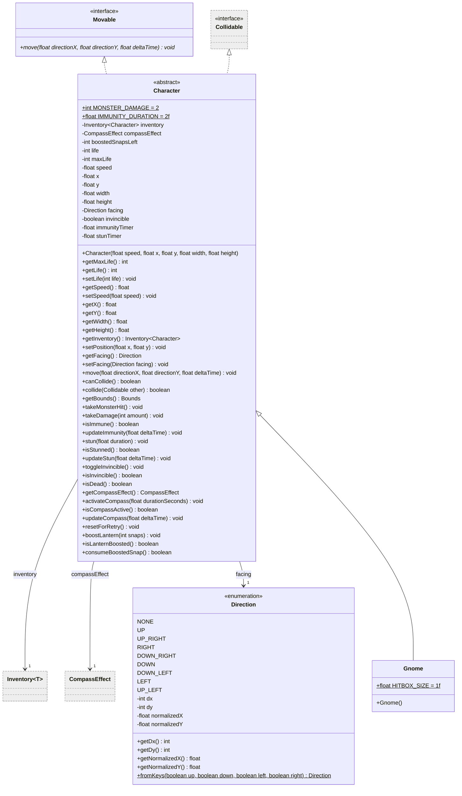

# UML : Personnage (héros)

Package `com.blindpath.domain.character`. Le gnome est le héros jouable ; `Character` porte la vie (en PV, 1 cœur = 2 PV), le stun et le déplacement en 8 directions.

Les classes grisées en pointillés viennent d'autres packages : leur détail est dans leur propre fichier.

