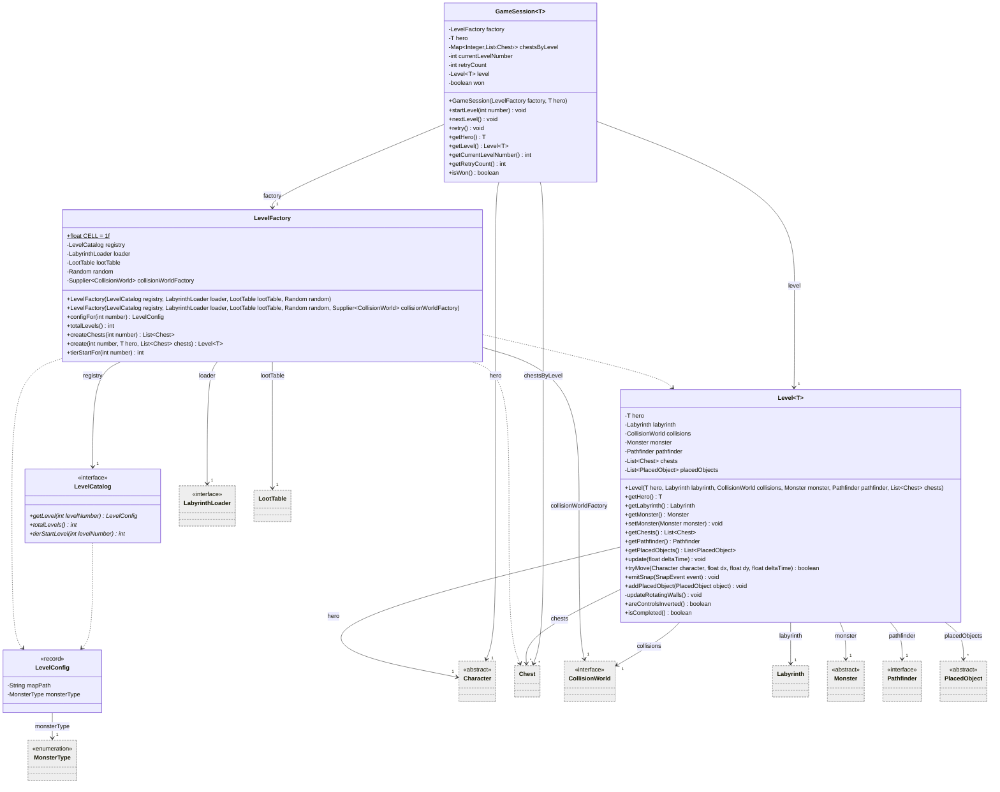

# UML : Jeu et niveaux

Package `com.blindpath.domain.game`. `GameSession` enchaîne les niveaux, `Level` assemble le héros, le labyrinthe, le monstre, les coffres et les objets posés. `LevelFactory` construit un niveau à partir de sa `LevelConfig` (patron **Fabrique**).

Les classes grisées en pointillés viennent d'autres packages : leur détail est dans leur propre fichier.

