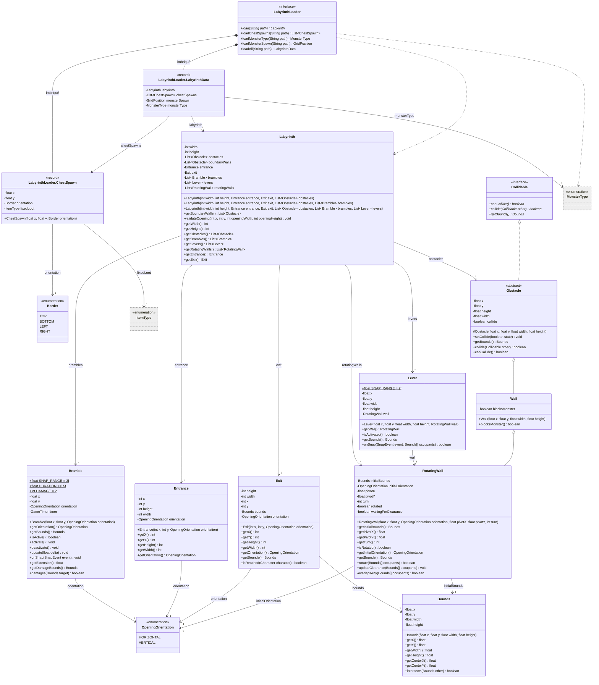

# UML : Labyrinthe et éléments de carte

Package `com.blindpath.domain.labyrinth`. Le labyrinthe, ses obstacles (murs, ronces, mur pivotant + levier), l'entrée et la sortie, et le contrat `Collidable`.

Les classes grisées en pointillés viennent d'autres packages : leur détail est dans leur propre fichier.

