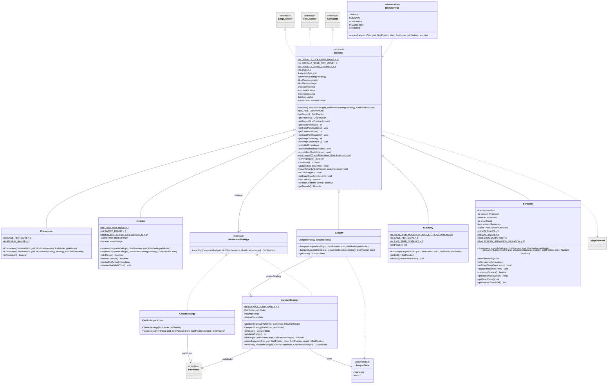

# UML : Monstres

Package `com.blindpath.domain.monster`.

Patrons de conception visibles ici :
- **Héritage** : `Monster` (abstraite) et ses 5 monstres.
- **Strategy** : `MovementStrategy`, implémentée par `ChaseStrategy` et `JumperStrategy`.
- **Fabrique** : l'enum `MonsterType` et sa méthode `create`.
- **Observer** : `Monster` écoute le claquement (`SnapListener`) et l'horloge (`TickListener`).

Les classes grisées en pointillés viennent d'autres packages : leur détail est dans leur propre fichier.

