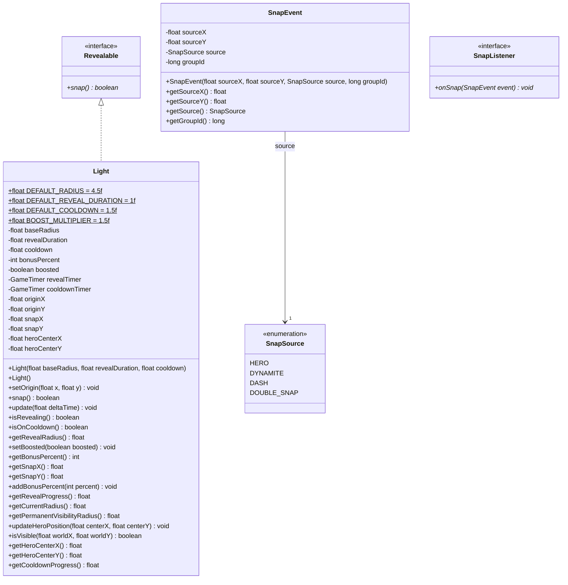

# UML : Lumière et claquement de doigts

Package `com.blindpath.domain.light`. La lanterne (`Light`) et le claquement (`SnapEvent`), diffusé aux `SnapListener` (patron **Observer**).

Les classes grisées en pointillés viennent d'autres packages : leur détail est dans leur propre fichier.

