# UML : Inventaire et objets

Packages `com.blindpath.domain.inventory` et `com.blindpath.domain.object`. Les 5 objets gardés (Compass, BearTrap, Dynamite, Heart, Booster) et les objets posés au sol, seuls à agir sur les monstres.

Les classes grisées en pointillés viennent d'autres packages : leur détail est dans leur propre fichier.

```mermaid
classDiagram
    direction TB
    %% ===== com.blindpath.domain.inventory =====
    namespace domain_inventory {
        class BearTrap {
            +BearTrap()
            +canUse(Character user, Level~?~ level) boolean
            +use(Character user, Level~?~ level) void
        }
        class Booster {
            +int BOOSTED_SNAPS = 5$
            +Booster()
            +canUse(Character user, Level~?~ level) boolean
            +use(Character user, Level~?~ level) void
        }
        class Compass {
            +float DEFAULT_DURATION = 5f$
            -float duration
            +Compass()
            +Compass(float duration)
            +getDuration() float
            +use(Character user, Level~?~ level) void
        }
        class CompassEffect {
            -float remainingTime
            +activate(float durationSeconds) void
            +update(float deltaTime) void
            +isActive() boolean
            +getRemainingTime() float
            +reset() void
            +computeAngleDegrees(Character user, Exit exit) float
        }
        class Dynamite {
            +Dynamite()
            +canUse(Character user, Level~?~ level) boolean
            +use(Character user, Level~?~ level) void
        }
        class Heart {
            +Heart()
            +canUse(Character user, Level~?~ level) boolean
            +use(Character user, Level~?~ level) void
        }
        class Inventory~T~ {
            -int maxSlots
            -int maxStackSize
            -List~ItemStack~ stacks
            -T owner
            +Inventory(T owner)
            +getOwner() T
            +add(Item items, int quantity) void
            +use(int slot, T user, Level~?~ level) boolean
            +getStacks() List~ItemStack~
            +useHealthNeeded(T user, Level~?~ level) void
        }
        class Item {
            <<abstract>>
            -String name
            #Item(String name)
            +getName() String
            +canUse(Character user, Level~?~ level) boolean
        }
        class ItemStack {
            -Item item
            -int quantity
            +ItemStack(Item item, int quantity)
            +getItem() Item
            +getQuantity() int
            ~add(int quantityToAdd) void
            ~rmv() void
        }
        class ItemType {
            <<enumeration>>
            HEART
            BEAR_TRAP
            BOOSTER
            DYNAMITE
            COMPASS
            -Supplier~Item~ constructor
            -boolean randomDroppable
            +create() Item
            +isRandomDroppable() boolean
        }
        class Usable {
            <<interface>>
            +canUse(Character user, Level~?~ level)* boolean
            +use(Character user, Level~?~ level)* void
        }
    }
    %% ===== com.blindpath.domain.object =====
    namespace domain_object {
        class PlacedBearTrap {
            +float TRAP_SIZE = 1f$
            +float IMMOBILITY_DURATION = 3f$
            -boolean hasTrapped
            +PlacedBearTrap(float x, float y)
            +onTouch(Monster monster) void
            +isDone() boolean
        }
        class PlacedDynamite {
            +float DYNAMITE_SIZE = 1f$
            +float COUNTDOWN_DURATION = 3f$
            -Level level
            -float countdownTimer
            -boolean hasExploded
            +PlacedDynamite(float x, float y, Level level)
            +onTouch(Monster monster) void
            +update(float deltaTime) void
            +isDone() boolean
        }
        class PlacedObject {
            <<abstract>>
            -float x
            -float y
            -float width
            -float height
            +PlacedObject(float x, float y, float width, float height)
            +canCollide() boolean
            +collide(Collidable other) boolean
            +getBounds() Bounds
            +onTouch(Monster monster)* void
            +isDone()* boolean
            +update(float deltaTime) void
        }
    }
    %% ===== Classes d'autres packages (detail dans leur propre fichier) =====
    class Character {
        <<abstract>>
    }
    class Collidable {
        <<interface>>
    }
    class Level~T~
    %% ===== Relations =====
    Item <|-- BearTrap
    Item <|-- Booster
    Item <|-- Compass
    Item <|-- Dynamite
    Item <|-- Heart
    Inventory --> "*" ItemStack : stacks
    Inventory --> "1" Character : owner
    Usable <|.. Item
    ItemStack --> "1" Item : item
    ItemType --> "1" Item : constructor
    PlacedObject <|-- PlacedBearTrap
    PlacedObject <|-- PlacedDynamite
    PlacedDynamite --> "1" Level : level
    Collidable <|.. PlacedObject
    style Character fill:#eeeeee,stroke:#999999,stroke-dasharray:4 3
    style Collidable fill:#eeeeee,stroke:#999999,stroke-dasharray:4 3
    style Level fill:#eeeeee,stroke:#999999,stroke-dasharray:4 3
```

