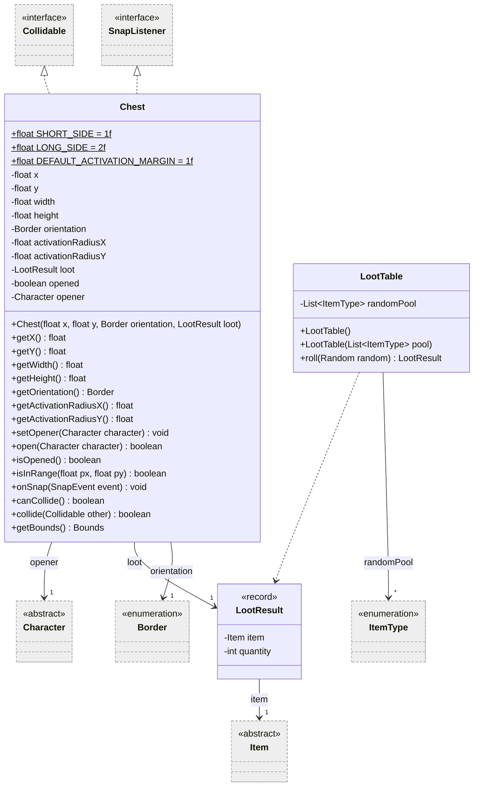

# UML : Coffres et butin

Package `com.blindpath.domain.chest`. Le coffre s'ouvre au claquement et donne un butin tiré dans la `LootTable`.

Les classes grisées en pointillés viennent d'autres packages : leur détail est dans leur propre fichier.

