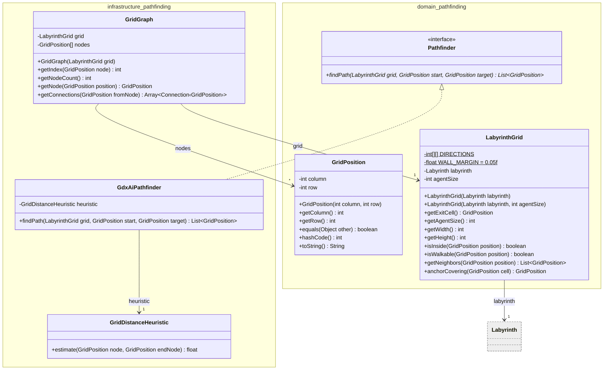

# UML : Pathfinding

Packages `com.blindpath.domain.pathfinding` (contrat, sans LibGDX) et `com.blindpath.infrastructure.pathfinding` (implémentation avec gdx-ai). Le domaine ne dépend que de l'interface `Pathfinder`.

Les classes grisées en pointillés viennent d'autres packages : leur détail est dans leur propre fichier.

