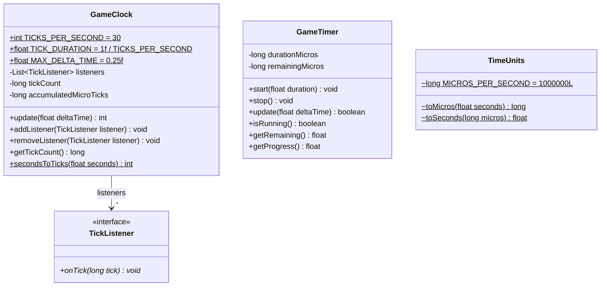

# UML : Temps : horloge et minuteurs

Package `com.blindpath.domain.time`. `GameClock` émet 30 ticks par seconde vers les `TickListener` (patron **Observer**) ; `GameTimer` sert aux durées (stun, immobilisation, cri…).

Les classes grisées en pointillés viennent d'autres packages : leur détail est dans leur propre fichier.

