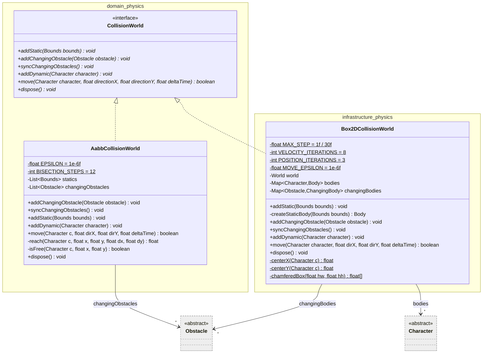

# UML : Physique et collisions

Packages `com.blindpath.domain.physics` (contrat + version simple AABB) et `com.blindpath.infrastructure.physics` (version Box2D).

Les classes grisées en pointillés viennent d'autres packages : leur détail est dans leur propre fichier.

