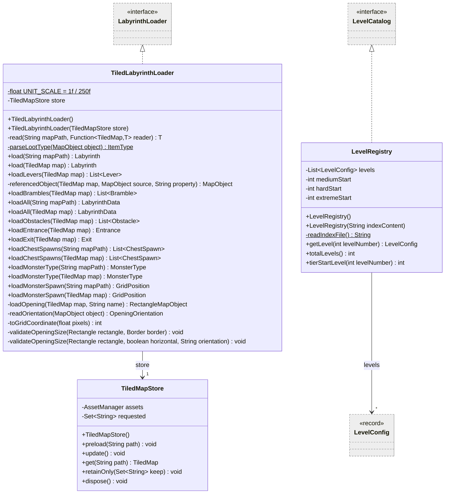

# UML : Chargement des cartes

Package `com.blindpath.infrastructure.map`. Lecture des cartes Tiled et catalogue des niveaux, derrière les interfaces du domaine `LabyrinthLoader` et `LevelCatalog`.

Les classes grisées en pointillés viennent d'autres packages : leur détail est dans leur propre fichier.

