# UML : Écrans, HUD, entrées et audio

Packages `com.blindpath` (Main) et `com.blindpath.presentation.screen`, `hud`, `input`, `audio`. Couche LibGDX. Pour rester lisible, seuls les membres publics et protégés sont affichés.

Les classes grisées en pointillés viennent d'autres packages : leur détail est dans leur propre fichier.

```mermaid
classDiagram
    direction LR
    %% ===== com.blindpath. =====
    namespace racine {
        class Main {
            +create() void
            +setScreen(Screen next) void
            +dispose() void
        }
    }
    %% ===== com.blindpath.presentation.screen =====
    namespace presentation_screen {
        class EndScreen {
            +EndScreen(Main main)
            +show() void
            +render(float delta) void
            +resize(int width, int height) void
            +pause() void
            +resume() void
            +hide() void
            +dispose() void
        }
        class GameScreen~T~ {
            +GameScreen(Main main, T hero)
            +show() void
            +render(float delta) void
            +resize(int width, int height) void
            +pause() void
            +resume() void
            +hide() void
            +dispose() void
        }
        class IntroScreen {
            +IntroScreen(Main main)
            +show() void
            +render(float delta) void
            +resize(int width, int height) void
            +pause() void
            +resume() void
            +hide() void
            +dispose() void
        }
        class MainMenuScreen {
            +MainMenuScreen(Main main)
            +show() void
            +render(float delta) void
            +resize(int width, int height) void
            +pause() void
            +resume() void
            +hide() void
            +dispose() void
        }
    }
    %% ===== com.blindpath.presentation.hud =====
    namespace presentation_hud {
        class Hud {
            +Hud()
            +update(float cooldownProgress, int life, List~ItemStack~ stacks, int levelNumber) void
            +setControlsInverted(boolean inverted, boolean ending) void
            +render(float delta) void
            +resize(int width, int height) void
            +dispose() void
        }
    }
    %% ===== com.blindpath.presentation.input =====
    namespace presentation_input {
        class InputController {
            +InputController(Level~?~ level)
            +InputController(Level~?~ level, Character character)
            +InputController(Level~?~ level, IntPredicate keyDown)
            +InputController(Level~?~ level, Character character, IntPredicate keyDown, IntPredicate keyJustPressed)
            +readDirection(IntPredicate keyDown)$ Direction
            +readDirection(IntPredicate keyDown, boolean inverted)$ Direction
            +handleInput(float deltaTime) void
            +isMoving() boolean
        }
    }
    %% ===== com.blindpath.presentation.audio =====
    namespace presentation_audio {
        class MenuAudio {
            +MenuAudio()
            +setActive(boolean active) void
            +dispose() void
        }
        class MonsterAudio {
            +MonsterAudio()
            +jumpscarePath(Monster monster)$ String
            +update(Monster monster, Character hero, boolean enabled) void
            +stop() void
            +dispose() void
        }
    }
    %% ===== Classes d'autres packages (detail dans leur propre fichier) =====
    class BrambleRenderer
    class Character {
        <<abstract>>
    }
    class CharacterRenderer~T~
    class ChestRenderer
    class CollisionDebugRenderer
    class CompassArrowRenderer
    class DamageOverlayRenderer
    class FogRenderer
    class GameClock
    class GameSession~T~
    class ItemStack
    class JumpscareRenderer
    class LabyrinthRenderer
    class Level~T~
    class LevelFactory
    class LeverWallRenderer
    class Light
    class Monster {
        <<abstract>>
    }
    class MonsterRenderer
    class PlacedObjectRenderer
    class TiledMapStore
    %% ===== Relations =====
    Main --> "1" MenuAudio : menuAudio
    MonsterAudio --> "1" Monster : trackedMonster
    InputController --> "1" Level : level
    InputController --> "1" Character : character
    EndScreen --> "1" Main : main
    GameScreen --> "1" Character : hero
    GameScreen --> "1" TiledMapStore : mapStore
    GameScreen --> "1" LabyrinthRenderer : renderer
    GameScreen --> "1" FogRenderer : fogRenderer
    GameScreen --> "1" Light : light
    GameScreen --> "1" Level : level
    GameScreen --> "1" LevelFactory : factory
    GameScreen --> "1" InputController : input
    GameScreen --> "1" CharacterRenderer : characterRenderer
    GameScreen --> "1" CollisionDebugRenderer : debugRenderer
    GameScreen --> "1" GameSession : session
    GameScreen --> "1" ChestRenderer : chestRenderer
    GameScreen --> "1" PlacedObjectRenderer : placedObjectRenderer
    GameScreen --> "1" BrambleRenderer : brambleRenderer
    GameScreen --> "1" LeverWallRenderer : leverWallRenderer
    GameScreen --> "1" Monster : monster
    GameScreen --> "1" MonsterRenderer : monsterRenderer
    GameScreen --> "1" GameClock : clock
    GameScreen --> "1" JumpscareRenderer : jumpscare
    GameScreen --> "1" DamageOverlayRenderer : damageOverlay
    GameScreen --> "1" Main : main
    GameScreen --> "1" CompassArrowRenderer : compassArrowRenderer
    GameScreen --> "1" Hud : hud
    GameScreen --> "1" MonsterAudio : monsterAudio
    IntroScreen --> "1" Main : main
    MonsterAudio ..> Character
    Hud ..> ItemStack
    MainMenuScreen ..> Main
    style BrambleRenderer fill:#eeeeee,stroke:#999999,stroke-dasharray:4 3
    style Character fill:#eeeeee,stroke:#999999,stroke-dasharray:4 3
    style CharacterRenderer fill:#eeeeee,stroke:#999999,stroke-dasharray:4 3
    style ChestRenderer fill:#eeeeee,stroke:#999999,stroke-dasharray:4 3
    style CollisionDebugRenderer fill:#eeeeee,stroke:#999999,stroke-dasharray:4 3
    style CompassArrowRenderer fill:#eeeeee,stroke:#999999,stroke-dasharray:4 3
    style DamageOverlayRenderer fill:#eeeeee,stroke:#999999,stroke-dasharray:4 3
    style FogRenderer fill:#eeeeee,stroke:#999999,stroke-dasharray:4 3
    style GameClock fill:#eeeeee,stroke:#999999,stroke-dasharray:4 3
    style GameSession fill:#eeeeee,stroke:#999999,stroke-dasharray:4 3
    style ItemStack fill:#eeeeee,stroke:#999999,stroke-dasharray:4 3
    style JumpscareRenderer fill:#eeeeee,stroke:#999999,stroke-dasharray:4 3
    style LabyrinthRenderer fill:#eeeeee,stroke:#999999,stroke-dasharray:4 3
    style Level fill:#eeeeee,stroke:#999999,stroke-dasharray:4 3
    style LevelFactory fill:#eeeeee,stroke:#999999,stroke-dasharray:4 3
    style LeverWallRenderer fill:#eeeeee,stroke:#999999,stroke-dasharray:4 3
    style Light fill:#eeeeee,stroke:#999999,stroke-dasharray:4 3
    style Monster fill:#eeeeee,stroke:#999999,stroke-dasharray:4 3
    style MonsterRenderer fill:#eeeeee,stroke:#999999,stroke-dasharray:4 3
    style PlacedObjectRenderer fill:#eeeeee,stroke:#999999,stroke-dasharray:4 3
    style TiledMapStore fill:#eeeeee,stroke:#999999,stroke-dasharray:4 3
```

