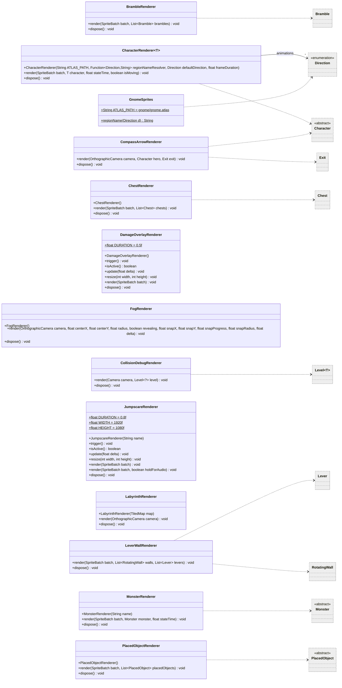

# UML : Rendu (renderers)

Package `com.blindpath.presentation.renderer`. Une classe de rendu par élément du jeu. Seuls les membres publics et protégés sont affichés.

Les classes grisées en pointillés viennent d'autres packages : leur détail est dans leur propre fichier.

